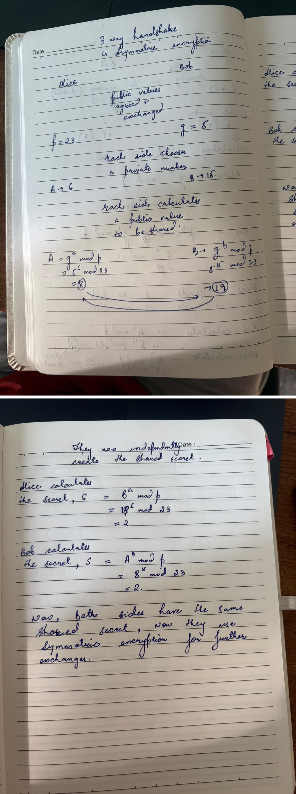
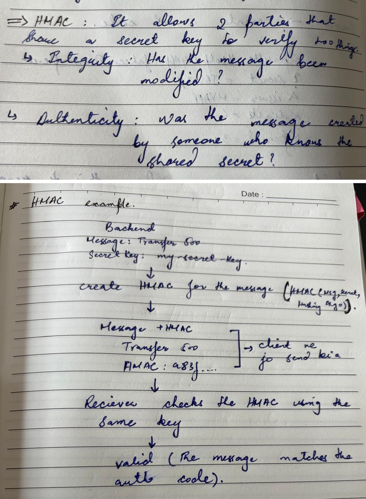
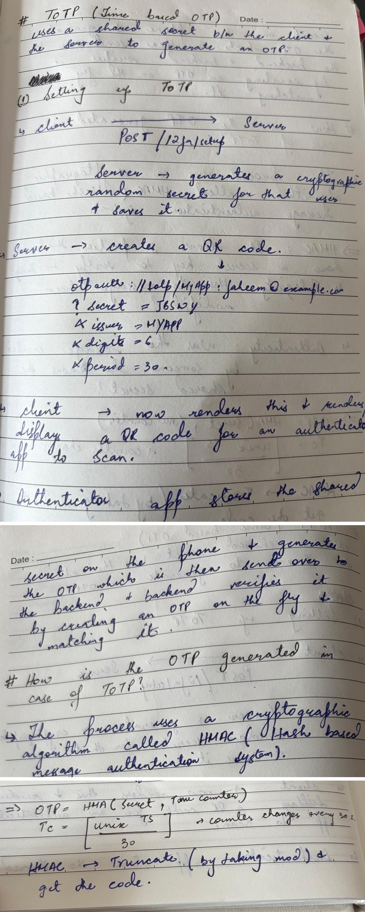
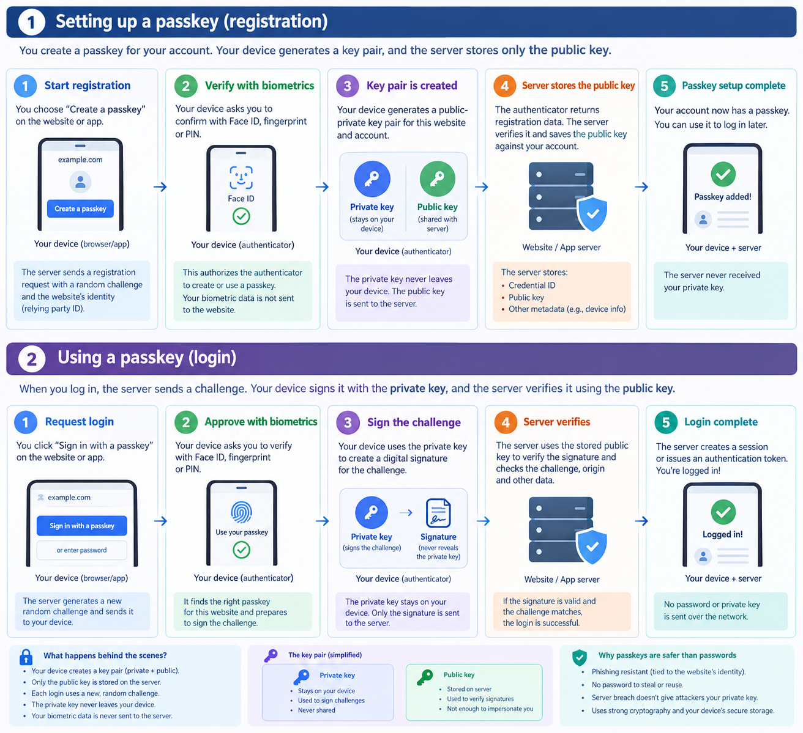
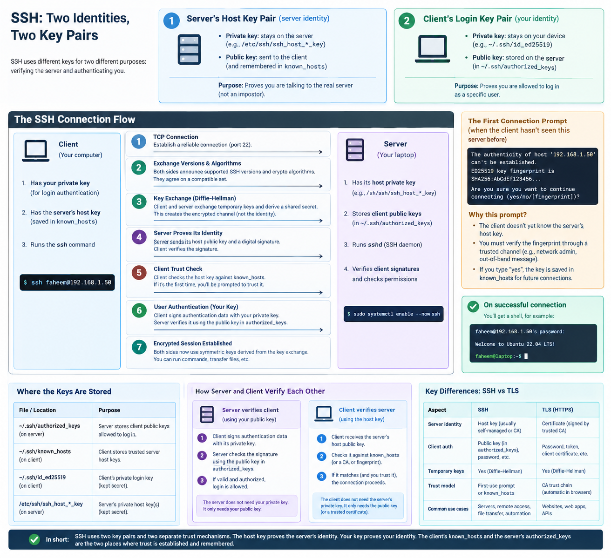
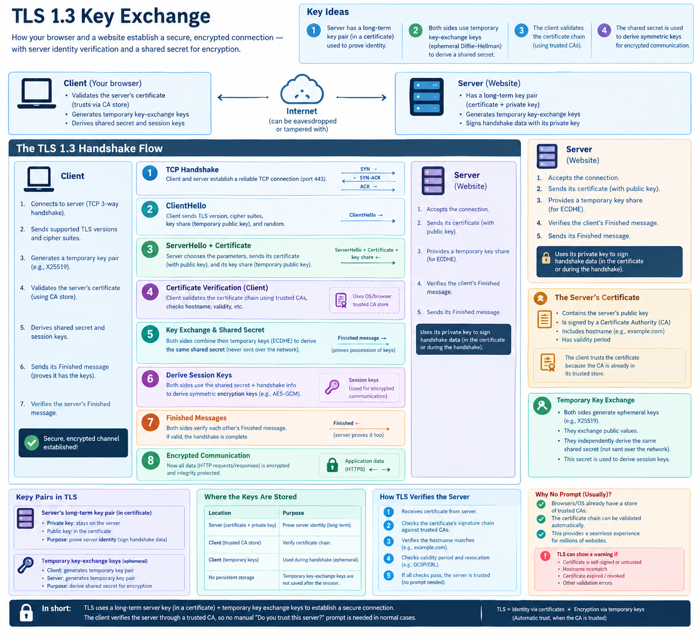
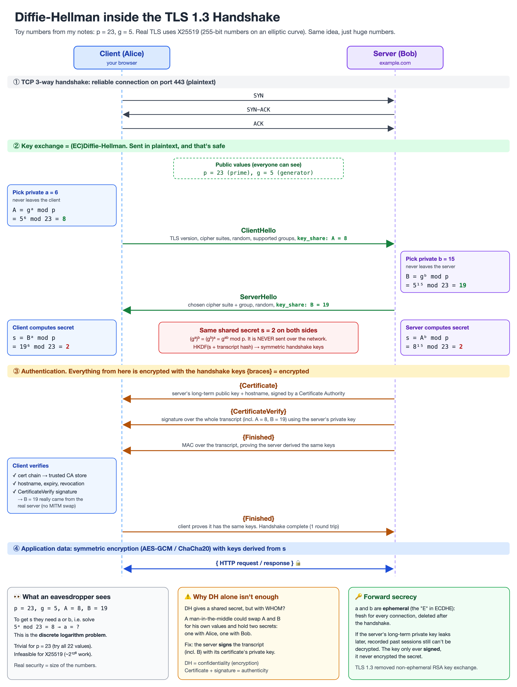

# Authentication and Authorization

- **Authentication**: The server knows your identity `(401 unauthorised)`.
- **Authorization**: The server knows your identity but the server checks which actions you're
  allowed to perform. `(403 forbidden)`

## Factor.
- We talk about two factor authentication, but what is a factor?
- A factor is a category of proof.
- 3 Factors: `Something you know` | `Something you have` | `Something you are`
- `Something you know`: Passwords, pins, security questions, answers etc.
- `Something you have`: Devices, passkeys, yubiKey etc.
- `Something you are`: Face, Fingerprint, voice etc.

- With multiple factor of authentication, it is really difficult for an attacker to
  get all three or two at the same time.

- Before diving deep, lets understand certain things like `encoding`, `encryption`, `hashing` and `signing`.
- `Encoding: ` can be reversed by anyone, doesn't need any secret key or something, represent data
  in a different format before transmitting.
- `Encryption: ` it needs a key to be reversed.
- `Hashing: ` it is impossible to reverse. Keep the data absolutely secret.
- `Signing: ` send a hash of the data signed with the private key along with the actual data,
  it proves who produced the data and that it wasn't changed in transit as the reciever checks the
  validity of the data with the corresponding public key.

## Passwords - Hashing and salts

- Passwords are never stored in plain texts in the db incase the db got compromised.
- They are hashed and then stored, but plain hashing has few problems.
- Same passwords have the same hashes and precomputed hash tables can be used to break
  few of the commonly used password.
- So, for the same password to have a different hash, we need to add a salt which is just a random
  number and the hash along with the salt is stored in the database.
- Even after all this, we need better hashing algorithms that take time and memory to compute hashes
  in order to slow down brute force attacks.
- Only passwords need slow hashes and not the random tokens being generated.

**Why random tokens don't need slow hashes?**
A 32-byte random token has `2²⁵⁶` possible values. Nobody can guess it, fast hash or not.
Slow hashing only matters for low-entropy human-chosen secrets like passwords.
So magic-link tokens and API keys are stored as plain SHA-256 hashes.

## Symmetric vs Asymmetric encryption

- `Symmetric encryption: ` both the parties hold a shared secret that they can use to encrypt and decrypt
  the messages exchanged. `Problem: ` shared secret being leaked.
- Used by: `passwords`, `HMAC`, `TOTP`, `API Keys`, `Kerberos`.
- Even `TLS` uses symmteric encryption after securing the connection using
  asymmetric encryption.

### Key Images for Understanding Symmetric Encryption

---

- Before jumping into asymmetric encryption we need to understand the difference between
  `signing` and `encryption`.
- `Signing: ` Signing proves authenticity and integrity(ki mai hi hun jisney data bheja aur
  data ke saath koi tampering nahi ki gayi while being in transit)
- `Encryption: ` Encryption provides confidentiality.

---

- `Asymmetric encryption: ` There are two keys - a public and a private key pair.
  The private key remains with you and the public key is shared and only the corresponding
  public key can decrypt data encrypted via the private key.
- Used by: `passkeys`, `SSH keys`, `TLS certificates`, `smart cards`,
  `JWTs signed with RS256/ES256`.
- `Strength:` The server only stores the public key and even if the db gets compromised,
  the attacker can do nothing.

**Passkeys**

**SSH**

**TLS**

**Smart Cards**

The same thing happens with the smart cards. The card has the public/private key stored securely
in it. A digital certificate is presented whose authenticity is verified by the card reader
against trusted issuers. Then the card reader sends a challenge and the smart card uses its
private key to sign it and prove its authenticity.